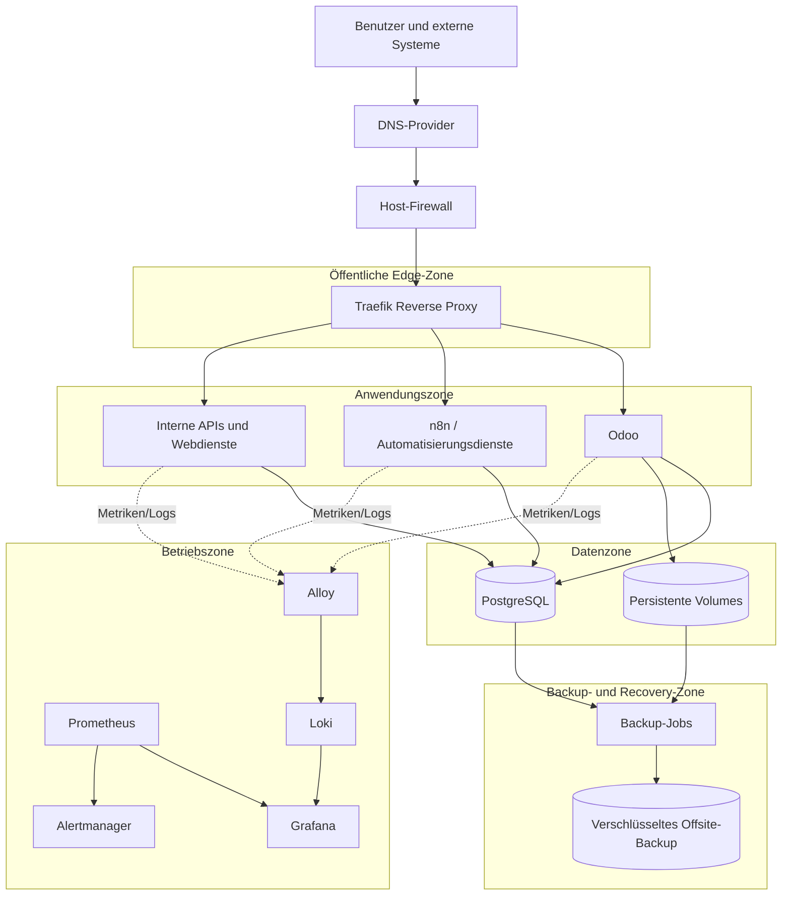

# Architektur der Merchfactory Infrastructure Platform

## 1. Zweck

Dieses Dokument definiert die Referenzarchitektur der Merchfactory Infrastructure Platform. Die Plattform stellt eine reproduzierbare, sichere und wartbare Betriebsgrundlage für geschäftskritische Dienste wie Odoo, Automatisierungsdienste, Webanwendungen, APIs, Datenbanken, Monitoring und Backup-Workloads bereit.

Der Zielzustand ist eine Plattform, die aus dem Repository auf einer Ersatzinfrastruktur neu aufgebaut werden kann, ohne von undokumentierten manuellen Schritten oder Chatverläufen abhängig zu sein.

## 2. Architekturprinzipien

Die Plattform folgt diesen Prinzipien:

1. **Infrastructure as Code** – Infrastrukturzustand, Konfiguration und Deployment-Logik werden versioniert verwaltet.
2. **Reproduzierbarkeit** – Ein sauber installierter Server kann durch dokumentierte Automatisierung in einen bekannten Plattformzustand überführt werden.
3. **Sicherheit als Standard** – Least Privilege, minimale Angriffsfläche, gehärtete Zugriffswege und explizite Vertrauensgrenzen sind verpflichtend.
4. **Trennung der Verantwortungsbereiche** – Bootstrap, Konfiguration, Deployment, Monitoring, Backup und Wiederherstellung bleiben eigenständige Schichten.
5. **Beobachtbarer Betrieb** – Relevante Zustände von Plattform, Hosts, Containern, Diensten und Backups sind messbar und alarmierbar.
6. **Wiederherstellbarkeit** – Jede kritische persistente Komponente benötigt einen getesteten Wiederherstellungspfad.
7. **Prüfbare Änderungen** – Änderungen folgen dem Ablauf Issue → Branch → Pull Request → Review → Merge.
8. **Kontrollierte Einfachheit** – Zusätzliche Betriebskomplexität muss durch konkrete geschäftliche oder verfügbarkeitsbezogene Anforderungen begründet sein.

## 3. Geltungsbereich

Die Referenzarchitektur umfasst:

- Bootstrap und Härtung von Linux-Servern
- Host- und Dienstkonfiguration
- Docker-basierte Anwendungslaufzeit
- Reverse Proxy und TLS-Terminierung
- interne und externe Netzwerksegmentierung
- Secret-Management
- persistente Datenspeicherung
- Monitoring, Logging und Alarmierung
- Backup und Restore
- Disaster Recovery
- GitHub-basierte Governance und CI/CD

Anwendungsspezifische Interna liegen außerhalb dieses Dokuments, sofern sie keine Auswirkungen auf Plattformgrenzen, Persistenz, Verfügbarkeit oder Sicherheit haben.

## 4. Logische Architektur



## 5. Plattformschichten

### 5.1 Governance-Schicht

Die Governance-Schicht definiert, wie Änderungen vorgeschlagen, umgesetzt, geprüft und freigegeben werden.

Verantwortungsbereiche:

- Issues und Milestones
- Pull Requests und Review-Regeln
- Branch-Schutz
- CODEOWNERS
- ADRs
- Release- und Versionierungskonventionen
- Repository-Standards

Keine produktionsrelevante Plattformänderung darf diese Schicht umgehen.

### 5.2 Bootstrap-Schicht

Die Bootstrap-Schicht bereitet ein sauberes Betriebssystem für den Plattformbetrieb vor.

Verantwortungsbereiche:

- unterstützte Betriebssystemversionen
- Paketquellen und Updates
- Benutzer, Gruppen und SSH-Zugriffe
- Firewall und Fail2ban
- Zeitsynchronisation und Locale
- Vorbereitung von Dateisystem und Verzeichnissen
- Installation von Docker Engine und Docker Compose
- Host-Inventar und Variablen

Die Bootstrap-Schicht muss idempotent sein.

### 5.3 Konfigurationsschicht

Die Konfigurationsschicht wendet wiederverwendbare Host- und Umgebungseinstellungen an.

Verantwortungsbereiche:

- umgebungsspezifische Variablen
- Hostgruppen und Serverrollen
- Konfigurationstemplates
- nicht sensible Standardwerte
- Validierungsregeln
- Dienstvoraussetzungen

Secrets dürfen in dieser Schicht nicht im Klartext gespeichert werden.

### 5.4 Deployment-Schicht

Die Deployment-Schicht verwaltet Plattform- und Anwendungsdienste.

Verantwortungsbereiche:

- Docker-Compose-Definitionen
- Reverse-Proxy-Routing
- TLS-Konfiguration
- Netzwerke und Volumes
- Healthchecks
- Ressourcenlimits
- Image-Versionen
- Update- und Rollback-Verfahren

Deployments müssen nach Möglichkeit gepinnte und prüfbare Versionen statt veränderlicher Tags verwenden.

### 5.5 Observability-Schicht

Die Observability-Schicht stellt Metriken, Logs, Dashboards und Alarme bereit.

Verantwortungsbereiche:

- Host-Metriken
- Container-Metriken
- Anwendungsmetriken
- zentrale Logs
- Endpunkt- und Zertifikatsprüfungen
- Backup-Status
- Dashboards
- Alarmrouting und Eskalation

Das Monitoring muss sowohl technische Ausfälle als auch schleichende betriebliche Verschlechterungen erkennen.

### 5.6 Backup- und Recovery-Schicht

Die Backup- und Recovery-Schicht schützt persistente Geschäftsdaten und Plattformzustände.

Verantwortungsbereiche:

- Datenklassifikation
- Backup-Matrix
- Datenbank-Backups
- Backups persistenter Volumes
- Wiederherstellungskonzepte für Konfigurationen und Secrets
- Verschlüsselung
- Offsite-Kopien
- Integritätsprüfungen
- Restore-Werkzeuge
- Recovery-Runbooks

Ein Backup gilt erst dann als belastbar, wenn sein Wiederherstellungspfad erfolgreich getestet wurde.

## 6. Serverrollen

Die initiale Plattform kann auf einem einzelnen abgesicherten VPS betrieben werden. Die Rollen werden jedoch logisch getrennt, damit sie später auf dedizierte Hosts verschoben werden können.

### 6.1 Edge-Rolle

Hosts oder Dienste der Edge-Rolle nehmen extern initiierte Verbindungen entgegen.

Typische Komponenten:

- Traefik
- öffentliche HTTP-/HTTPS-Einstiegspunkte
- ACME-Statusdaten
- begrenzt veröffentlichte administrative Endpunkte

Die Edge-Rolle darf Datenbankdienste nicht direkt veröffentlichen.

### 6.2 Anwendungsrolle

Die Anwendungsrolle betreibt geschäftliche Dienste.

Typische Komponenten:

- Odoo
- n8n
- interne APIs
- kundenspezifische Dienste

Anwendungscontainer kommunizieren ausschließlich über explizit definierte Netzwerke mit Datendiensten.

### 6.3 Datenrolle

Die Datenrolle speichert persistente Geschäftsdaten.

Typische Komponenten:

- PostgreSQL
- Anwendungsdateispeicher
- persistente Docker-Volumes

Die Datenrolle darf nicht direkt aus dem öffentlichen Internet erreichbar sein.

### 6.4 Betriebsrolle

Die Betriebsrolle stellt Transparenz und Steuerungsmöglichkeiten für die Plattform bereit.

Typische Komponenten:

- Prometheus
- Grafana
- Loki
- Alloy
- Alertmanager

Administrative Zugriffe müssen durch Authentifizierung und Netzwerkbeschränkungen geschützt werden.

### 6.5 Backup-Rolle

Die Backup-Rolle erstellt, prüft und überträgt Backups.

Typische Verantwortungsbereiche:

- geplante Backup-Jobs
- Umsetzung der Aufbewahrungsregeln
- Integritätsprüfung
- verschlüsselte Offsite-Übertragung
- Vorbereitung von Wiederherstellungen

Das Backup-Ziel muss administrativ oder geografisch vom Primärserver getrennt sein.

## 7. Netzwerkmodell

Die Plattform verwendet explizite logische Netzwerkzonen.

| Zone | Zweck | Internetfreigabe | Typische Mitglieder |
|---|---|---:|---|
| Öffentliche Edge-Zone | Annahme von HTTP-/HTTPS-Verkehr | Ja | Traefik |
| Anwendungszone | Betrieb geschäftlicher Dienste | Keine direkte Freigabe | Odoo, n8n, APIs |
| Datenzone | Speicherung persistenter Daten | Nein | PostgreSQL, Datendienste |
| Betriebszone | Monitoring und Administration | Eingeschränkt | Grafana, Prometheus, Loki |
| Backup-Zone | Erstellung und Übertragung von Backups | Eingeschränkt ausgehend | Backup-Jobs, Offsite-Ziel |

Regeln:

- Nur der Reverse Proxy veröffentlicht öffentliche Anwendungsports.
- Datenbanken werden niemals öffentlich veröffentlicht.
- Container werden nur mit den für ihre Funktion benötigten Netzwerken verbunden.
- Administrative Dienste benötigen separate Authentifizierung und eingeschränktes Routing.
- Backup-Verkehr verwendet dedizierte Zugangsdaten und minimale Berechtigungen.
- Für die Host-Firewall wird eine Default-Deny-Strategie bevorzugt.

## 8. Containerplattform

Docker Engine mit dem Compose-Plugin ist der initiale Laufzeitstandard.

Jede Dienstdefinition soll mindestens enthalten:

- gepinnte Image-Version
- Restart-Policy
- benötigte Netzwerke
- persistente Volumes
- Healthcheck
- Ressourcenlimits, sofern sinnvoll
- Logging-Konfiguration
- Backup-Klassifikation
- Traefik-Labels nur bei erforderlichem externem Routing
- explizite Abhängigkeiten, ohne sich ausschließlich auf die Container-Startreihenfolge zu verlassen

Kubernetes ist nicht Bestandteil der initialen Zielarchitektur. Eine spätere Bewertung ist möglich, wenn Skalierung, Verfügbarkeit oder organisatorische Anforderungen die zusätzliche Betriebskomplexität rechtfertigen.

## 9. Datenflüsse

### 9.1 Externer Anfragefluss

1. Ein Client löst die Dienstdomain über DNS auf.
2. Der Verkehr erreicht die Host-Firewall.
3. Zulässiger HTTP-/HTTPS-Verkehr wird an Traefik weitergeleitet.
4. Traefik terminiert TLS und wendet Routing sowie Middleware an.
5. Die Anfrage erreicht den Zielcontainer über ein internes Docker-Netzwerk.
6. Die Anwendung greift über ein separates internes Netzwerk auf die benötigten Datendienste zu.

### 9.2 Deployment-Fluss

1. Eine Änderung beginnt mit einem GitHub-Issue.
2. Die Arbeit erfolgt auf einem eigenen Arbeitsbranch.
3. Die CI prüft Syntax, Tests und Richtlinienanforderungen.
4. Ein Pull Request wird geprüft und gemergt.
5. Die Deployment-Automatisierung wendet die freigegebene Version an.
6. Healthchecks und Monitoring validieren das Ergebnis.
7. Fehlgeschlagene Validierungen lösen Rollback oder einen manuellen Eingriff aus.

### 9.3 Backup-Fluss

1. Geplante Jobs bestimmen die relevante Datenquelle.
2. Ein anwendungskonsistentes Datenbank- oder Volume-Backup wird erstellt.
3. Backup-Metadaten und Prüfsummen werden erzeugt.
4. Die Daten werden vor oder während der Übertragung verschlüsselt.
5. Das verschlüsselte Backup wird an das Offsite-Ziel übertragen.
6. Das Monitoring erfasst Erfolg, Alter, Dauer, Größe und Validierungsstatus.

### 9.4 Wiederherstellungsfluss

1. Der Vorfall wird klassifiziert und das Recovery-Runbook aktiviert.
2. Ersatzinfrastruktur wird bereitgestellt.
3. Der Bootstrap bereitet den Host vor.
4. Containerplattform und Betriebsdienste werden wiederhergestellt.
5. Secrets werden wiederhergestellt oder rotiert.
6. Datenbanken und persistente Volumes werden wiederhergestellt.
7. DNS und TLS werden validiert.
8. Technische und fachliche Smoke Tests werden ausgeführt.
9. Die Plattform wird formell wieder für den Betrieb freigegeben.

## 10. Sicherheitsgrenzen

Folgende Grenzen sind verbindlich:

- Öffentlicher Verkehr endet an der Edge-Schicht.
- Administrative Zugriffe sind von öffentlichen Anwendungszugriffen getrennt.
- Datendienste bleiben intern.
- Secrets sind vom Repository-Inhalt getrennt.
- CI/CD-Identitäten erhalten nur die für ihre Aufgabe erforderlichen Berechtigungen.
- Backup-Zugangsdaten sind von Anwendungszugangsdaten getrennt.
- Die Kompromittierung eines Offsite-Backups darf keinen administrativen Zugriff auf Produktion ermöglichen.
- Logs müssen Secrets und sensible Nutzdaten soweit möglich ausschließen.

## 11. Verfügbarkeitsmodell

Die initiale Plattform priorisiert Reproduzierbarkeit und Wiederherstellbarkeit gegenüber vollständiger Hochverfügbarkeit.

Annahmen für die Startphase:

- Ein einzelner primärer VPS kann mehrere logische Rollen betreiben.
- Dienstneustart und Hostaustausch sind akzeptierte Wiederherstellungsmechanismen.
- Der Schutz kritischer Daten basiert auf getesteten Backups und Offsite-Kopien.
- Monitoring muss Fehler schnell erkennen.
- RPO- und RTO-Werte werden später pro Dienst und Datenklasse festgelegt.

Horizontale Skalierung oder Hochverfügbarkeitskonzepte müssen über ADRs eingeführt werden und benötigen eine konkrete geschäftliche Begründung.

## 12. Umgebungsmodell

Das Zielmodell umfasst:

- **development** – lokale oder isolierte Entwicklung und technische Integration
- **staging** – produktionsnahe Verifikation vor einer Freigabe
- **production** – kontrollierter Live-Betrieb

Automatisierte Tests sind Bestandteil der CI und benötigen nicht zwingend eine dauerhaft betriebene eigene Umgebung. Nicht jede Umgebung benötigt einen dedizierten physischen Server. Logische Trennung, eigenständige Konfigurationen und explizite Promotion-Pfade sind jedoch auch bei gemeinsam genutzter Infrastruktur verpflichtend.

Environment, Host-Rolle und physisches Placement sind voneinander unabhängig. ADR-0009 definiert dafür die Profile `development-only`, `compact`, `standard` und `split-production`. Der aktuelle Aufbau verwendet ausschließlich `development-only`; Staging und Production sind vorbereitete Promotion-Ziele, aber noch keine laufenden Systeme.

## 13. Zuordnung zur Repository-Struktur

Die Architektur wird auf folgende Repository-Struktur abgebildet:

```text
.github/        GitHub-Governance und Workflows
bootstrap/      Host-Provisionierung und Härtung
configuration/  Gemeinsame und umgebungsspezifische Konfiguration
 deployment/     Deployment-Definitionen für Dienste und Plattform
monitoring/     Metriken, Logs, Dashboards und Alarme
backup/         Backup-Jobs und Richtlinien
restore/        Restore-Werkzeuge und Recovery-Verfahren
scripts/        Hilfsskripte für Entwicklung und Betrieb
templates/      Wiederverwendbare Dienst- und Konfigurationstemplates
tests/          Automatisierte Validierungs- und Recovery-Tests
docs/           Architektur, Standards, ADRs und Runbooks
examples/       Referenzimplementierungen
```

## 14. Architekturentscheidungen mit ADR-Pflicht

Folgende Entscheidungen benötigen eigenständige ADRs:

- Branching- und Änderungsworkflow
- Umgebungsmodell
- Repository-Verzeichnisstruktur
- Infrastructure-as-Code-Ansatz
- Docker und Compose als initiale Containerstrategie
- Security-First-Baseline
- Backup- und Offsite-Strategie
- Secret-Management-Verfahren
- unterstützte Betriebssysteme
- Monitoring-Stack

## 15. Validierungskriterien

Die Architektur gilt als umgesetzt, wenn:

- alle Plattformschichten entsprechende Repository-Strukturen besitzen,
- der Bootstrap einen sauberen unterstützten Server vorbereiten kann,
- die Containerplattform einen Referenzdienst bereitstellen kann,
- Netzwerkgrenzen technisch durchgesetzt werden,
- Monitoring und Alarmierung kritische Komponenten abdecken,
- Backups verschlüsselt, offsite gespeichert und überwacht werden,
- Restore- und Disaster-Recovery-Tests erfolgreich sind,
- die Dokumentation einen Betrieb ohne undokumentiertes Wissen ermöglicht.

## 16. Offene Entscheidungen

Folgende Punkte bleiben bewusst für spätere ADRs oder milestone-spezifische Ausarbeitungen offen:

- endgültige unterstützte Linux-Distribution und Versionsmatrix
- Secret-Management-Backend
- konkreter Offsite-Backup-Anbieter
- endgültige RPO-/RTO-Ziele je Dienst
- Betrieb von Datenbanken in Containern oder auf dedizierten Hosts
- langfristige Anforderungen an Hochverfügbarkeit

## Referenzen

- Issue #3
- Epic #2
- `docs/00-vision.md`
- `docs/02-adr/README.md`
