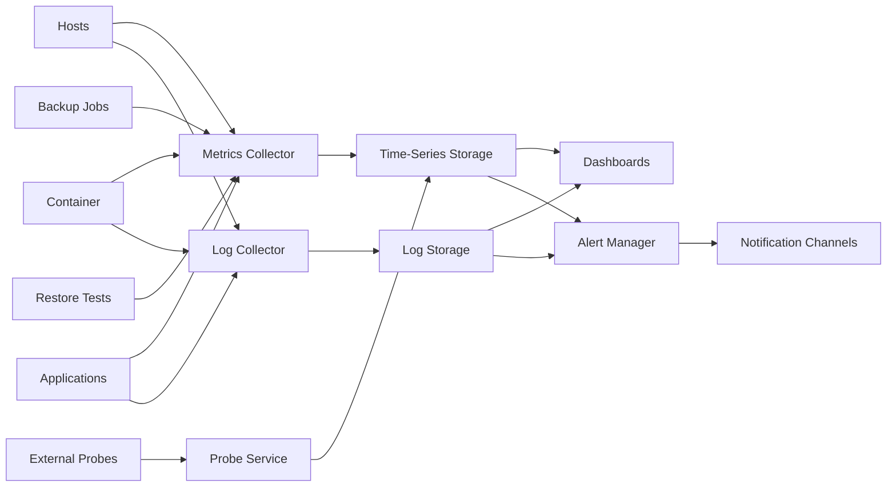

# Monitoring & Observability

## Zweck

Dieses Dokument definiert die verbindliche Monitoring- und Observability-Baseline der Merchfactory Infrastructure Platform. Ziel ist, Ausfälle, Leistungsprobleme, Sicherheitsereignisse sowie fehlerhafte Backup- und Recovery-Prozesse frühzeitig zu erkennen und nachvollziehbar zu behandeln.

## Geltungsbereich

Die Anforderungen gelten für Development, Staging und Production sowie für produktive, interne und optionale Infrastrukturkomponenten.

Abgedeckt werden insbesondere:

- Host-Systeme und Betriebssysteme
- Container Runtime und Container
- Reverse Proxy und TLS
- Anwendungen und interne Dienste
- Datenbanken und persistente Speicher
- Backup- und Restore-Prozesse
- Netzwerk- und externe Erreichbarkeit
- CI/CD- und Deployment-Vorgänge
- sicherheitsrelevante Systemereignisse

## Grundprinzipien

1. Monitoring muss unabhängig vom überwachten Dienst funktionieren.
2. Kritische Signale müssen aktiv alarmieren und dürfen nicht nur in Dashboards sichtbar sein.
3. Metriken, Logs, Traces und Healthchecks werden getrennt erfasst, aber gemeinsam korreliert.
4. Produktionsdaten und personenbezogene Daten dürfen nicht unkontrolliert in Logs gelangen.
5. Jede Alarmregel benötigt einen Besitzer, eine Priorität und einen dokumentierten Reaktionsweg.
6. Monitoring-Ausfälle sind selbst zu überwachen.
7. Backup-Erfolg ohne nachgewiesene Wiederherstellbarkeit gilt nicht als vollständiger Schutz.

## Zielarchitektur

Die konkrete Produktauswahl ist in ADR-0008 verbindlich festgelegt. Verwendet werden Prometheus, Alertmanager, Grafana, Loki, Grafana Alloy, Node Exporter, cAdvisor und Blackbox Exporter. Versionen und technische Verträge stehen in `configuration/monitoring-stack.json` und `docs/61-monitoring-stack.md`.

## Monitoring-Ebenen

### 1. Infrastruktur

Zu erfassen sind mindestens:

- CPU-Auslastung, Load und Steal Time
- RAM-Nutzung, Swap und OOM-Ereignisse
- Dateisystembelegung, Inodes und I/O-Latenzen
- Netzwerkdurchsatz, Paketverluste und Fehler
- System-Uptime und unerwartete Neustarts
- Zeitsynchronisation
- Kernel-, Hardware- und Dateisystemfehler
- verfügbare Sicherheits- und Systemupdates

### 2. Container-Plattform

Zu erfassen sind mindestens:

- Containerstatus und Restart-Zähler
- CPU- und RAM-Verbrauch je Container
- Healthcheck-Status
- Image-Version beziehungsweise Digest
- fehlgeschlagene Starts
- Container ohne definierte Ressourcenlimits
- CPU-Nutzung relativ zum Hard Limit und CPU-Throttling
- Memory-Nutzung relativ zu Reservation und Hard Limit
- OOM-Ereignisse und `OOMKilled`
- PID-Nutzung relativ zum Limit
- ungewöhnlich hohe Lograten
- Zustand der Container-Netzwerke und Volumes

### 3. Reverse Proxy, DNS und TLS

Zu erfassen sind mindestens:

- externe Erreichbarkeit
- HTTP-Status und Antwortzeit
- TLS-Zertifikatsgültigkeit
- Zertifikatsablauf mit Vorwarnung
- DNS-Auflösung
- Rate von 4xx- und 5xx-Antworten
- fehlgeschlagene ACME-Erneuerungen
- ungewöhnliche Request-Spitzen

### 4. Anwendungen

Jede Anwendung stellt mindestens bereit:

- Liveness-Check
- Readiness-Check
- Versions- oder Buildinformation
- strukturierte Fehlerlogs
- zentrale technische Kennzahlen

Abhängig vom Dienst sind zusätzlich zu überwachen:

- Queue-Länge
- Job-Laufzeiten
- Fehlerquote
- externe API-Abhängigkeiten
- Datenbankverbindungen
- Verarbeitung eingehender Bestellungen
- fehlgeschlagene Übertragungen zwischen Shopify, internen Diensten und DecoNetwork

Geschäftsmetriken dürfen keine unnötigen personenbezogenen Daten enthalten.

### 5. Datenbanken und persistente Daten

Zu erfassen sind mindestens:

- Verfügbarkeit
- Verbindungsanzahl
- Transaktions- und Abfragefehler
- langsame Abfragen
- Replikationsstatus, sofern vorhanden
- Datenbankgröße und Wachstumsrate
- verfügbare Speicherkapazität
- Backup-Status
- Integritätsfehler

### 6. Backup und Recovery

Für jeden Backup-Job werden mindestens erfasst:

- Startzeit
- Endzeit
- Laufzeit
- Status
- gesicherte Datenmenge
- Zielsystem
- Alter des letzten erfolgreichen Backups
- Prüfsummen- oder Integritätsstatus

Für Restore-Tests werden mindestens erfasst:

- letzter erfolgreicher Restore-Test
- getesteter Datenbestand
- benötigte Wiederherstellungszeit
- Abweichung vom RTO
- Datenverlustfenster im Verhältnis zum RPO

Ein Alarm ist auszulösen, wenn:

- ein geplanter Backup-Lauf ausbleibt
- ein Backup fehlschlägt
- das letzte erfolgreiche Backup älter als die definierte Schwelle ist
- ein Restore-Test nicht fristgerecht durchgeführt wurde
- ein Restore-Test fehlschlägt

## Logging

### Format

Anwendungen und Plattformdienste sollen strukturierte Logs, bevorzugt JSON, erzeugen.

Pflichtfelder:

- Zeitstempel in UTC
- Service
- Umgebung
- Host oder Instanz
- Severity
- Event oder Nachricht
- Korrelations-ID, sofern verfügbar
- Version oder Build

### Severity

- `DEBUG`: nur temporär und nicht standardmäßig in Production
- `INFO`: normaler Betriebsablauf
- `WARN`: Abweichung ohne unmittelbaren Ausfall
- `ERROR`: fehlgeschlagener Vorgang mit Betriebsrelevanz
- `CRITICAL`: akuter Ausfall, Datenverlust oder Sicherheitsvorfall

### Datenschutz

Nicht protokolliert werden dürfen:

- Passwörter
- API-Tokens
- private Schlüssel
- Session-Cookies
- vollständige Zahlungsdaten
- unnötige personenbezogene Inhalte
- vollständige Produktionsdateien oder kundenspezifische Druckdaten

Personenbezogene Identifikatoren sind nach Möglichkeit zu pseudonymisieren oder durch interne Referenzen zu ersetzen.

## Healthchecks

Das verbindliche Modell ist in `docs/54-healthcheck-standards.md` definiert.

Die Plattform trennt drei Signale:

- **Liveness:** lokaler Prozess lebt und kann Fortschritt machen; Docker Compose, Standard 30s/5s/3.
- **Readiness:** Instanz kann jetzt produktiv Requests verarbeiten; bei HTTP-Diensten aktiver Traefik-Healthcheck, Standard 10s/3s/HTTP 200.
- **External Probe:** Client-Sicht über DNS, TLS, Reverse Proxy und Anwendung; Standard 30s/5s.

Remote-Abhängigkeiten werden nicht pauschal in Liveness aufgenommen. Zwingende Abhängigkeiten des Request-Pfads dürfen Readiness beeinflussen; andere Dependencies erhalten eigene Metriken und Alerts.

Ein Docker-`unhealthy`-Status löst nicht automatisch einen Neustart aus. Ein Readiness-Fehler entfernt das betroffene Backend aus der Traefik-Rotation. Externe Probes bleiben unabhängig von beiden internen Signalen.

## Verbindliches Betriebs-Runbook (v0.6)

Die konkrete Alarmannahme, nichtdestruktive Diagnose, Zuständigkeiten und
Eskalation werden in [Monitoring-Runbook #97](80-monitoring-runbook.md)
beschrieben. Die dortige Abdeckungsprüfung schützt davor, neue Alertnamen
ohne dokumentierte Maßnahme einzuführen. Live-Alarmtests bleiben Aufgabe
von #98; es wird keine zusätzliche Monitoring-Plattform aufgebaut.

## Alarmklassen

### P1 – Kritisch

Beispiele:

- Production vollständig nicht erreichbar
- Datenbank nicht verfügbar
- akuter Datenverlust
- kritischer Sicherheitsvorfall
- alle aktuellen Backups unbrauchbar

Reaktion:

- sofortige Benachrichtigung
- Beginn der Bearbeitung innerhalb von 15 Minuten während definierter Rufbereitschaft
- Eskalation an technische Verantwortung und Geschäftsführung bei längerer Auswirkung

### P2 – Hoch

Beispiele:

- wesentliche Teilfunktion gestört
- stark erhöhte Fehlerquote
- Backup fehlgeschlagen
- Datenträger erreicht kritische Kapazität
- Zertifikat läuft kurzfristig ab

Reaktion:

- Benachrichtigung unmittelbar
- Bearbeitung innerhalb von 60 Minuten während Betriebszeiten

### P3 – Mittel

Beispiele:

- erhöhte Ressourcenlast
- einzelner nichtkritischer Dienst gestört
- anstehende Kapazitätsgrenze
- wiederkehrende Warnungen

Reaktion:

- Bearbeitung innerhalb eines Arbeitstags

### P4 – Information

Beispiele:

- geplante Wartung
- erfolgreicher Restore-Test
- Deployment abgeschlossen
- nicht dringende Optimierungshinweise

Reaktion:

- Aufnahme in Betriebsübersicht oder regelmäßigen Bericht

## Alarmqualität

Jede Alarmregel enthält:

- eindeutigen Namen
- betroffene Umgebung und Komponente
- Schwellwert oder Bedingung
- Priorität
- verantwortliche Rolle
- Runbook- oder Dokumentationslink
- Eskalationsweg
- Hinweis zur Verifikation und Entstörung

Nicht handlungsfähige Daueralarme sind zu korrigieren oder zu entfernen. Alarmunterdrückung während Wartungsfenstern muss zeitlich begrenzt und dokumentiert sein.

## Benachrichtigung und Eskalation

Mindestens vorzusehen sind:

- sofortiger technischer Kanal für P1 und P2
- E-Mail oder Ticket für P3
- regelmäßige Zusammenfassung für P4

Produktionsalarme dürfen nicht ausschließlich an eine einzelne Person gebunden sein. Empfänger werden rollenbasiert definiert.

## Dashboards

### Executive Overview

- Gesamtstatus Production
- Verfügbarkeit kritischer Dienste
- aktuelle P1- und P2-Alarme
- Backup- und Restore-Status
- laufende Deployments
- Kapazitätsrisiken

### Infrastructure Dashboard

- Hosts
- CPU, RAM, Disk und Netzwerk
- Containerstatus
- Zertifikate
- Systemupdates

### Application Dashboard

- Requests
- Latenz
- Fehlerquote
- Jobs und Queues
- externe Abhängigkeiten
- Bestell- und Integrationsfehler

### Backup & Recovery Dashboard

- letzter erfolgreicher Lauf je Backup
- Backup-Alter
- Laufzeit und Datenvolumen
- fehlgeschlagene Jobs
- letzter Restore-Test
- RPO- und RTO-Abweichungen

### Security Dashboard

- fehlgeschlagene SSH-Anmeldungen
- Fail2ban-Status
- Firewall-Ereignisse
- privilegierte Zugriffe
- sicherheitsrelevante Systemänderungen
- offene kritische Schwachstellen

## Aufbewahrung

Richtwerte:

- hochauflösende Metriken: mindestens 30 Tage
- verdichtete Metriken: mindestens 12 Monate
- Debuglogs: maximal 7 Tage
- Standardlogs: 30 Tage
- Fehlerlogs: 90 Tage
- Security- und Auditlogs: 365 Tage
- Deployment- und Backup-Nachweise: 365 Tage

Diese zentralen Zielwerte sind in `configuration/logging-policy.json` maschinenlesbar hinterlegt. Lokale Container- und Hostlogs besitzen bewusst kürzere und größenbegrenzte Buffer gemäß `docs/56-log-rotation.md`.

## Kapazitätsmanagement

Monitoring-Speicher erhält eigene Grenzwerte und Alarme. Zu überwachen sind:

- tägliches Datenwachstum
- Host-Dateisystembelegung mit Warning ab 75 % und Critical ab 85 %
- verbleibende Aufbewahrungsdauer
- Ingestion-Fehler
- verworfene Metriken oder Logs
- Abfragezeiten
- Speicherbelegung

Bei Kapazitätsengpässen dürfen kritische Alarm- und Auditdaten nicht zuerst verworfen werden.

## Umgebungen

### Development

- reduzierte Aufbewahrung
- ausführlichere Debug-Möglichkeiten
- keine produktiven Kundendaten
- Alarmierung primär an Entwicklung

### Staging

- produktionsnahe Checks
- Validierung von Dashboards und Alarmregeln
- Deployment- und Restore-Tests
- gleiche kritische Signale wie Production, aber getrennte Empfänger

### Production

- vollständige Überwachung
- verbindliche Alarm- und Eskalationswege
- eingeschränkter Debug-Zugriff
- höhere Aufbewahrungs- und Nachweisanforderungen

## Verantwortlichkeiten

### Platform Owner

- Monitoring-Architektur
- zentrale Alarmregeln
- Verfügbarkeit der Monitoring-Plattform
- Aufbewahrung und Kapazität

### Service Owner

- dienstspezifische Metriken und Healthchecks
- fachliche Fehlerbilder
- Runbooks
- Alarmprüfung nach Änderungen

### Security Owner

- Audit- und Sicherheitslogs
- Sicherheitsalarme
- Zugriffskontrolle
- Datenschutzprüfung

### Backup Owner

- Backup-Monitoring
- Restore-Test-Nachweise
- RPO- und RTO-Prüfung

## Prüfintervalle

- täglich: aktive P1/P2-Alarme, Backup-Status, Monitoring-Verfügbarkeit
- wöchentlich: Alarmrauschen, Kapazität, Zertifikate, wiederkehrende Fehler
- monatlich: Dashboard- und Alarmreview, Empfänger, Aufbewahrung
- quartalsweise: Restore-Test, Eskalationswege, Runbooks, SLO-Prüfung
- jährlich: vollständige Architektur- und Datenschutzprüfung

## Betriebsanforderungen

- Monitoring-Komponenten werden gesichert und reproduzierbar konfiguriert.
- Dashboards und Alarmregeln werden versioniert.
- Konfigurationsänderungen erfolgen über Pull Requests.
- Produktionszugriff wird protokolliert.
- Monitoring muss nach einem Server-Neuaufbau automatisch wiederherstellbar sein.
- Kritische externe Probes dürfen nicht ausschließlich auf demselben Host wie der überwachte Dienst laufen.

## Freigabe der Containerplattform

Die v0.5 Container Platform ist gemäß `docs/58-container-platform-validation.md` als Runtime-Grundlage für die Monitoring-Implementierung validiert.

Diese Freigabe bedeutet nicht, dass der Monitoring-Stack bereits implementiert oder produktiv freigegeben ist. Die konkrete Produktauswahl, externe Probe-Architektur, Alarmierungswege und SLOs bleiben Teil der Monitoring-Umsetzung.

## Architekturentscheidung

ADR-0008 legt den Monitoring-Stack fest.

Noch in den zugehörigen v0.6-Arbeitspaketen zu konkretisieren sind:

- Alarmierungs- und Benachrichtigungskanäle (#92),
- unabhängiger externer Probe-Pfad (#95),
- konkrete Aufbewahrungs- und Kapazitätsgrenzen (#96),
- SLO- und Error-Budget-Modell im späteren Betriebsreview.

## Referenzen

- Issue #8
- Epic #2
- `docs/03-server-layout.md`
- `docs/04-security.md`
- `docs/05-cicd.md`
- `docs/06-deployment.md`
- `docs/02-adr/ADR-0006-security-first.md`
- `docs/02-adr/ADR-0007-backup-strategy.md`
- `docs/54-healthcheck-standards.md`
- `docs/55-container-resource-limits.md`
- `docs/56-log-rotation.md`
- `docs/58-container-platform-validation.md`
- `docs/02-adr/ADR-0008-monitoring-stack.md`
- `docs/61-monitoring-stack.md`
