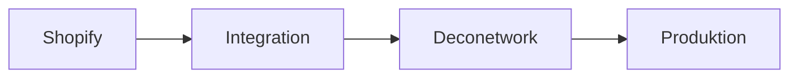

# Dokumentationsstandards

## Zweck

Dieses Dokument definiert verbindliche Standards für Aufbau, Sprache, Diagramme, Querverweise, Pflege und Review technischer Dokumentation.

## Grundprinzipien

Dokumentation ist Teil der Änderung und kein nachgelagerter Zusatz. Sie muss korrekt, auffindbar, wartbar, versionsnah und für die jeweilige Zielgruppe verständlich sein.

## Sprache

Die Projektdokumentation wird grundsätzlich auf Deutsch verfasst. Technische Begriffe, Dateinamen, Variablen, Befehle und etablierte Produktnamen bleiben in ihrer üblichen englischen Schreibweise.

Regeln:

- klare, direkte Sätze
- keine unnötigen Marketingformulierungen
- Fachbegriffe beim ersten Auftreten erklären
- Begriffe projektweit einheitlich verwenden
- keine personenbezogenen oder kundenspezifischen Informationen ohne Notwendigkeit
- keine Secrets, Tokens oder realen Zugangsdaten

## Dokumenttypen

### Standard- und Governance-Dokumente

Definieren verbindliche Regeln. Mindestinhalte:

- Zweck
- Geltungsbereich
- verbindliche Regeln
- gültige und ungültige Beispiele
- Ausnahmen
- Definition of Done oder Prüfkriterien
- Referenzen

### Architekturübersichten

Beschreiben Systemgrenzen, Komponenten und Datenflüsse. Mindestinhalte:

- Ziel und Kontext
- Komponenten und Verantwortlichkeiten
- Schnittstellen
- Sicherheits- und Betriebsgrenzen
- relevante Diagramme
- bekannte Einschränkungen
- ADR-Referenzen

### ADRs

Dokumentieren eine konkrete Architekturentscheidung. Mindestinhalte:

```text
Status
Kontext
Entscheidung
Alternativen
Konsequenzen
Referenzen
```

Ein ADR wird erstellt, wenn eine Entscheidung langfristige Auswirkungen auf Architektur, Sicherheit, Betrieb, Datenmodell oder Integrationsgrenzen hat.

### Runbooks und Betriebsanleitungen

Mindestinhalte:

- Zweck und Voraussetzungen
- betroffene Systeme
- sichere Schrittfolge
- Verifikation
- Fehlerfälle
- Rollback oder Recovery
- Eskalationshinweise

### Referenzdokumentation

Beschreibt Formate, Variablen, Ports, Endpunkte oder Inventare. Sie enthält Typen, Pflichtwerte, Defaults, Beispiele und Validierungsregeln.

### Review- und Prüfberichte

Enthalten Prüfbereich, Kriterien, Feststellungen, Abweichungen, Risiken, Entscheidungen und offene Punkte.

## Aufbau

Jedes Dokument beginnt mit einer eindeutigen H1-Überschrift. Überschriften werden hierarchisch ohne Sprünge verwendet.

Bevorzugte Reihenfolge:

1. Zweck
2. Geltungsbereich oder Kontext
3. Regeln oder Ablauf
4. Beispiele
5. Ausnahmen und Risiken
6. Definition of Done oder Prüfkriterien
7. Referenzen

Sehr lange Dokumente erhalten ein Inhaltsverzeichnis nur dann, wenn die Navigation dadurch messbar verbessert wird.

## Dateinamen und Ablage

Die Regeln aus `docs/25-file-directory-naming-conventions.md` gelten verbindlich.

Nummerierte Standards unter `docs/` verwenden:

```text
NN-thema.md
```

Neue Dokumente werden dort abgelegt, wo ihre fachliche Verantwortung liegt. Doppelte Dokumentation desselben Sachverhalts wird vermieden; stattdessen werden Querverweise verwendet.

## Markdown

- GitHub-Flavored Markdown verwenden
- Codeblöcke mit Sprachkennung versehen
- Tabellen nur für strukturierte Vergleiche
- lange Fließtextblöcke durch sinnvolle Abschnitte gliedern
- Befehle kopierbar und ohne Shell-Prompt darstellen
- Platzhalter eindeutig markieren

Beispiel:

```bash
git pull --ff-only origin main
```

Platzhalter:

```text
<environment>
<service-name>
<commit-sha>
```

## Beispiele

Beispiele müssen:

- syntaktisch plausibel sein
- dem aktuellen Standard entsprechen
- keine echten Secrets enthalten
- keine produktiven personenbezogenen Daten enthalten
- klar als Beispiel erkennbar sein

Ungültige Beispiele werden mit Begründung dokumentiert, wenn sie typische Fehlanwendungen verhindern.

## Mermaid-Diagramme

Mermaid wird bevorzugt für versionierbare Architektur-, Ablauf- und Abhängigkeitsdiagramme verwendet.

Geeignete Diagrammtypen:

- `flowchart` für Abläufe und Systemgrenzen
- `sequenceDiagram` für Schnittstellenabläufe
- `stateDiagram-v2` für Zustände
- `classDiagram` nur für tatsächlich hilfreiche Datenmodelle

Beispiel:



Regeln:

- Diagramme benötigen erklärenden Text
- Knoten verwenden stabile technische Namen
- Farben sind nicht die einzige Bedeutungsträgerin
- keine Secrets, internen IP-Adressen oder Kundendaten
- komplexe Diagramme werden aufgeteilt statt unlesbar verkleinert
- Diagramm und Text dürfen sich nicht widersprechen

Externe Bilddateien werden nur verwendet, wenn Mermaid fachlich nicht ausreicht. Die Quelldatei muss mit versioniert werden, sofern möglich.

## ADR-Nutzung

Ein ADR ist erforderlich bei:

- neuer zentraler Technologie oder Plattform
- Änderung von Sicherheits- oder Netzwerkgrenzen
- dauerhaftem Datenmodell oder Speicherverfahren
- neuem Deployment- oder Betriebsmodell
- inkompatibler Schnittstellenentscheidung
- bewusster Abweichung von einem bestehenden Standard

Kein ADR ist erforderlich für reine Textkorrekturen, kleine kompatible Implementierungsdetails oder die bloße Anwendung eines bestehenden Standards.

ADRs werden nicht nachträglich umgeschrieben, um die Entscheidungsgeschichte zu verbergen. Eine neue Entscheidung ersetzt ein altes ADR durch ein neues ADR mit Referenz.

## Querverweise

Querverweise verwenden relative Repository-Pfade:

```text
`docs/20-release-tagging-strategy.md`
```

Issues, Pull Requests und ADRs werden mit ihrer eindeutigen Nummer genannt. Ein Dokument darf nicht ausschließlich auf externe URLs angewiesen sein, wenn die zentrale Information im Repository gepflegt werden kann.

Bei Umbenennungen müssen alle internen Links aktualisiert werden.

## Aktualisierungspflicht

Eine Änderung aktualisiert im selben Pull Request alle betroffenen Dokumente, insbesondere:

- Architekturübersichten
- Konfigurationsreferenzen
- Deployment- und Runbooks
- Sicherheits- und Backupregeln
- Beispiele und Diagramme
- Release- und Migrationshinweise

Ein PR darf nicht als vollständig gelten, wenn Implementierung und Dokumentation widersprüchlich sind.

## Review

Das Review prüft:

1. fachliche Richtigkeit
2. Konsistenz mit bestehenden Standards
3. verständliche Zielgruppe und Sprache
4. gültige Beispiele und Befehle
5. aktualisierte Querverweise
6. Secret- und Datenschutzprüfung
7. Diagrammkonsistenz
8. Migration, Verifikation und Rollback, sofern relevant

## Veraltete Dokumentation

Veraltete Inhalte werden nicht kommentarlos liegen gelassen. Zulässige Maßnahmen:

- aktualisieren
- durch neues Dokument ersetzen und deutlich verweisen
- mit Begründung entfernen
- als historisch kennzeichnen, wenn weiterhin relevant

Begriffe wie `old`, `final2` oder unklare Archivkopien sind nicht zulässig.

## Verantwortlichkeit

Die Person oder der PR, der eine Änderung einführt, ist für die zugehörige Dokumentationsanpassung verantwortlich. Für übergreifende Standards erfolgt zusätzlich ein Governance-Review.

## Definition of Done für Issue #48

- Dokumenttypen und Mindestinhalte sind definiert.
- Sprache, Aufbau, Markdown und Beispiele sind geregelt.
- Mermaid- und ADR-Nutzung sind verbindlich beschrieben.
- Querverweise und Ablage sind festgelegt.
- Aktualisierungs- und Reviewpflichten sind dokumentiert.

## Referenzen

- `docs/10-development-guidelines.md`
- `docs/15-branch-commit-conventions.md`
- `docs/25-file-directory-naming-conventions.md`
- Issue #48
- Epic #35
