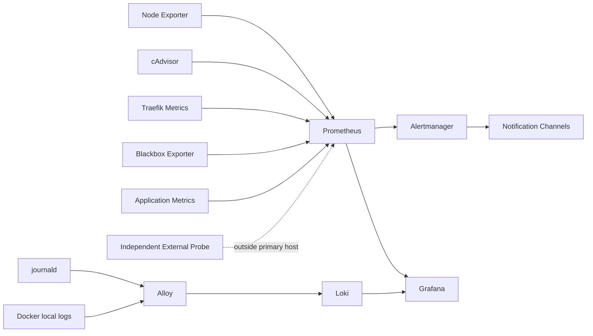

# Monitoring-Stack v0.6

## Zweck

Dieses Dokument konkretisiert ADR-0008 für die Umsetzung der v0.6-Issues #85 bis #99.

Maschinenlesbare Quelle:

```text
configuration/monitoring-stack.json
```

## Komponenten

| Komponente | Version | Betriebsform | Aufgabe |
|---|---:|---|---|
| Prometheus | 3.14.0 | Container | Metriken, Rules, TSDB |
| Alertmanager | 0.34.0 | Container | Alert-Routing und Zustellung |
| Grafana OSS | 13.2.2 | Container | Dashboards und Query UI |
| Loki | 3.7.7 | Container | zentrale Logspeicherung |
| Grafana Alloy | 1.19.2 | systemd Host-Agent | journald- und Docker-Logs |
| Node Exporter | 1.12.1 | systemd Host-Agent | Hostmetriken |
| cAdvisor | 0.60.5 | systemd Host-Agent | Containermetriken |
| Blackbox Exporter | 0.28.0 | Container | DNS/TLS/HTTP-Probes |

Containerimages werden bei der jeweiligen Implementierung zusätzlich per SHA-256-Digest festgeschrieben. Ein SemVer-Tag allein ist kein Deployment-Artefakt.

## Datenfluss



## Deploymentgrenzen

### Containerisierte zentrale Dienste

Containerisiert werden:

- Prometheus,
- Alertmanager,
- Grafana,
- Loki,
- Blackbox Exporter.

Sie folgen den v0.5-Standards für:

- Digest-Pinning,
- Ressourcenlimits,
- read-only Root-FS soweit vom Upstream unterstützt,
- Capability-Drop,
- `no-new-privileges`,
- Healthchecks,
- Persistenz,
- Managed-Labels,
- Update/Rollback.

### Host-Agenten

Als systemd-Dienste laufen:

- Node Exporter,
- cAdvisor,
- Grafana Alloy.

Die Host-Agenten sind bewusst keine normalen Compose-Services, weil sie Host-/cgroup-/journald- beziehungsweise Docker-Daemon-Sicht benötigen.

Sie erhalten:

- gepinnte Upstream-Version,
- Prüfsummenverifikation,
- eigene Service-User soweit technisch möglich,
- systemd-Ressourcenlimits,
- systemd-Hardening,
- keine öffentliche Weboberfläche,
- Firewall-/Source-Allowlisting.

## Docker-Logs

Der Docker-Daemon bleibt auf:

```text
log-driver=local
20m × 5
compression=true
```

Alloy liest Containerlogs über die lokale Docker-API.

Der Docker-Unix-Socket wird **nicht** an normale Monitoring-Container weitergereicht.

Alloy wird deshalb als besonders vertrauenswürdiger Host-Agent behandelt.

Dasselbe Trust-Modell gilt für cAdvisor: der Agent läuft lokal als `root` und verwendet ausschließlich `unix:///var/run/docker.sock`. Diese Berechtigung ist bewusst auf den Host-Agenten begrenzt; normale Monitoring- und Anwendungscontainer erhalten den Docker-Socket weiterhin nicht.

## Prometheus

Baseline:

```text
scrape_interval: 30s
evaluation_interval: 30s
retention.time: 30d
retention.size: 8GiB vorläufige Sicherheitsgrenze
remote write receiver: disabled
admin API: disabled
```

Prometheus bleibt Pull-basiert.

Die konkrete Implementierung aus #85 liegt unter `deployment/monitoring/prometheus/` und `monitoring/prometheus/`. Prometheus hängt ausschließlich am internen Shared-Netz `merchfactory-monitoring`, besitzt keinen Host-Port und keinen Edge-Zugang. Das 8-GiB-Cap wird in #96 anhand realer Last überprüft.

## Loki

Baseline:

```text
deployment mode: monolithic / single binary
storage: TSDB + local filesystem
tenant model: single tenant
public API: none
```

Loki wird nur intern von Grafana und Alloy verwendet.

Die konkrete Implementierung aus #89 liegt unter `deployment/monitoring/loki/` und `monitoring/loki/`. Das offizielle Image läuft als UID/GID `10001:10001`, besitzt keinen Host-Port und hängt ausschließlich am internen Monitoring-Netz.

Für den aktuellen `development-only`-Host gilt vorläufig:

```text
retention: 168h / 7 Tage
Kapazitätsziel: 4 GiB beobachteter Loki-Datenbestand
Hard Size Cap: nein
```

Das 4-GiB-Ziel ist ausdrücklich **kein** von Loki erzwungenes Speicherlimit. Filesystem-Loki löscht anhand der Retention und nicht aufgrund freien Plattenplatzes. Host-Disk-Alarme bleiben daher die Schutzgrenze. Die finalen Retention-Selektoren, Production-/Staging-Werte und Speichergrenzen werden in #96 implementiert.

## Grafana

Grafana bleibt als administrative Monitoring-Oberfläche intern. Es besitzt keinen Host-Port, keinen öffentlichen DNS-Eintrag und keine Traefik-Route. Bis zur VPN-Einführung erfolgt der Zugriff per SSH-Tunnel; Prometheus und Loki werden ausschließlich über interne Service-DNS-Namen angesprochen.

Pflicht:

- Anonymous Auth aus,
- Login erforderlich,
- Admin-Secret aus Datei,
- Datasources provisioniert,
- Dashboards provisioniert,
- keine Secrets in Dashboard-JSON.

## Alertmanager

Alertmanager 0.34.0 läuft als einzelne gehärtete Instanz unter `172.30.250.30:9093` im internen Netz `merchfactory-monitoring`. Er besitzt keinen Host-Port, keinen DNS-Eintrag und keine Traefik-Route. Prometheus sendet über `alertmanager:9093`.

Silences und Notification Log werden unter `/srv/merchfactory/persistent/monitoring/alertmanager` persistent gespeichert. Der Prozess läuft als `65534:65534`, das Root-Dateisystem ist read-only und alle Linux-Capabilities sind entfernt.

Routing gruppiert nach `environment`, `service`, `alertname` und `severity`. Inhibition unterdrückt niedrigere Severities bei Critical- sowie Down/Unavailable-Alarmen. #91 verwendet ausschließlich Null-Receiver und benötigt deshalb keinen Egress. Reale SMTP-/Webhook-Empfänger, Credentials und kontrollierter Outbound-Zugang folgen separat mit #92.

Auf dem einzelnen VPS bleibt High Availability bewusst deaktiviert. Für einen administrativen Zugriff kann lokal getunnelt werden:

```powershell
ssh -N -L 9093:172.30.250.30:9093 BENUTZER@SERVER-IP
```

Danach ist die Oberfläche unter `http://127.0.0.1:9093` erreichbar.

## Blackbox Exporter

Blackbox Exporter bleibt intern und erhält kontrollierten Outbound-Egress.

Probe-Arten:

- DNS,
- TCP,
- TLS,
- HTTP/HTTPS.

Für kritische öffentliche Dienste ist zusätzlich mindestens ein Probe-Pfad außerhalb des Primärhosts erforderlich.

## Netzwerk

### Core

Interne Kommunikation:

```text
Grafana <-> Prometheus
Grafana <-> Loki
Prometheus -> Alertmanager
Prometheus -> Blackbox Exporter
```

### Edge

Keine Monitoring-Oberfläche wird regulär an das Edge-Netz angeschlossen. Öffentlich bleiben ausschließlich explizit freigegebene Websites.

### Egress

Outbound wird separat begründet:

- Alertmanager: erst ab #92 für konfigurierte Notification Channels.
- Blackbox Exporter: externe Probeziele.

Andere zentrale Monitoring-Komponenten erhalten keinen allgemeinen Egress nur aus Bequemlichkeit.

### Host-Agenten

Node Exporter, cAdvisor und Alloy werden nicht über öffentliche Firewall-Services freigegeben.

Node Exporter ist mit #86 als gehärteter systemd-Host-Agent umgesetzt. Das interne Netz `merchfactory-monitoring` verwendet `172.30.250.0/24`; Node Exporter lauscht ausschließlich auf dem Host-Gateway `172.30.250.1:9100`. Zusätzlich begrenzt die systemd-Unit den IP-Zugriff auf das Monitoring-Subnetz. Port 9100 wird nicht in der öffentlichen Firewall-Zone geöffnet.

Prometheus scrapt Node Exporter per Pull über `monitoring/prometheus/targets/node-exporter.yml`. cAdvisor ist mit #87 als privilegierter systemd-Host-Agent auf `172.30.250.1:8080` integriert und wird über `monitoring/prometheus/targets/cadvisor.yml` gescrapt.

## Persistenz

```text
/srv/merchfactory/persistent/monitoring/prometheus
/srv/merchfactory/persistent/monitoring/grafana
/srv/merchfactory/persistent/monitoring/loki
/srv/merchfactory/persistent/monitoring/alertmanager
/var/lib/merchfactory/alloy
```

Alle Verzeichnisse erhalten explizite UID/GID- und Mode-Verträge bei der jeweiligen Implementierung.

## Ressourcen

### Zentrale Container

| Komponente | CPU Limit | Memory Limit | Reservation | PIDs |
|---|---:|---:|---:|---:|
| Prometheus | 1.0 | 1536 MiB | 768 MiB | 256 |
| Loki | 1.0 | 1536 MiB | 768 MiB | 256 |
| Grafana | 0.5 | 512 MiB | 256 MiB | 256 |
| Alertmanager | 0.25 | 256 MiB | 128 MiB | 128 |
| Blackbox Exporter | 0.25 | 128 MiB | 64 MiB | 128 |

### Host-Agenten

| Agent | CPUQuota | MemoryMax |
|---|---:|---:|
| Alloy | 50 % | 512 MiB |
| Node Exporter | 25 % | 128 MiB |
| cAdvisor | 50 % | 512 MiB |

Die Werte sind initiale Sicherheitsobergrenzen. #96 muss reale Ingestion, Cardinality, Diskwachstum und Host-Headroom messen und gegebenenfalls anpassen.

## Labelmodell

Pflichtlabels für Metriken und Logs:

- `environment`
- `host`
- `service`
- `component`

Zusätzlich nur bei stabiler, begrenzter Kardinalität:

- `project`
- `container`
- `severity`

Nicht als Labels verwenden:

- Request-ID,
- Order-ID,
- User-ID,
- E-Mail,
- vollständige URL mit dynamischen Parametern,
- Stacktrace,
- freie Fehlermeldung.

Damit wird unkontrollierte Cardinality verhindert.

## Security-Anforderungen

### Ingress

- Grafana: kein öffentlicher Zugriff; SSH-Tunnel, später VPN.
- Prometheus: kein öffentlicher Zugriff.
- Alertmanager: kein öffentlicher Zugriff.
- Loki: kein öffentlicher Zugriff.
- Blackbox Exporter: kein öffentlicher Zugriff.
- Alloy UI: nicht öffentlich.
- Node Exporter/cAdvisor: nur Scrape-Quelle.

### Secrets

Datei-basierte Übergabe gemäß `docs/51-secret-management.md`.

Dazu gehören insbesondere:

- Grafana Admin-Bootstrap,
- SMTP/Webhook-Credentials,
- zukünftige OAuth/OIDC-Secrets,
- externe Probe-Credentials.

### APIs

Nicht aktiviert werden:

- Docker TCP API,
- Prometheus Admin API,
- Prometheus Remote-Write-Receiver in der Baseline,
- anonyme Grafana-Administration,
- öffentliches Loki-Ingest.

### Updates

Jede Komponente:

1. Upstream-Version festlegen.
2. Image/Binary-Checksum oder Digest verifizieren.
3. Security Scan durchführen.
4. Staging prüfen.
5. identischen Digest nach Production promoten.
6. Rollback-Version erhalten.

## Retention und Kapazität (#96)

Die verbindliche Unterscheidung zwischen bereits durchgesetzten Development-Limits,
Zielklassen für spätere Umgebungen, Kapazitätsabschätzungen und noch offenen
Runtime-Messungen steht in [docs/79-monitoring-retention-capacity.md](79-monitoring-retention-capacity.md).
Der read-only Konsistenzprüfer `scripts/validate-monitoring-retention.py`
validiert den vorhandenen Entwicklungsvertrag gegen Compose, Loki und Logging-Policy.
Ein 4-GiB-Loki-Budget ist **kein hartes Volume-Quota**, und die globalen
7 Tage Loki stellen **keine** 30-/90-/365-Tage-Klassen-Retention dar.

## Retention

Vorläufig:

- Prometheus Rohmetriken: 30 Tage.
- Loki Development: 7 Tage globale Retention bis #96.
- Logklassen gemäß `configuration/logging-policy.json` bleiben das Zielmodell für spätere Staging-/Production-Profile.
- Loki Filesystem-Storage besitzt kein natives hartes Size-Cap; das dokumentierte 4-GiB-Ziel wird bis #96 über Disk-Monitoring abgesichert.

#96 ist zuständig für:

- reale Tagesingestion,
- Cardinality,
- benötigten Speicher,
- Loki-Retention-Selektoren,
- Prometheus Size Limit,
- Umgang mit dem Ziel „12 Monate verdichtete Metriken“.

Kein zusätzlicher Mimir-/Thanos-Cluster wird vor dieser Messung eingeführt.

## Hochverfügbarkeit

v0.6 startet bewusst Single-Node.

Nicht behauptet werden:

- HA Prometheus,
- HA Loki,
- HA Grafana,
- HA Alertmanager.

Die Plattform soll Ausfälle erkennen und reproduzierbar wiederherstellbar sein. Echte Komponenten-HA wird erst eingeführt, wenn Verfügbarkeitsanforderung und Infrastruktur dies rechtfertigen.

## Umsetzungsreihenfolge

Empfohlen:

```text
#84 Architektur
  -> #85 Prometheus
  -> #86 Node Exporter
  -> #87 Container-Metriken
  -> #89 Loki
  -> #90 Alloy
  -> #88 Grafana
  -> #91 Alertmanager
  -> #92 Notification Channels
  -> #93 Dashboards
  -> #94 Backup Monitoring
  -> #95 External Probes
  -> #96 Retention/Capacity
  -> #97 Runbook
  -> #98 Alarmtests
  -> #99 Review
```

Grafana kann technisch vor Loki/Alloy bereitgestellt werden; die oben genannte Reihenfolge priorisiert jedoch zuerst funktionierende Datenquellen.

## Referenzen

- ADR-0008
- Epic #83
- Issues #84–#99
- `docs/08-monitoring.md`
- `docs/54-healthcheck-standards.md`
- `docs/55-container-resource-limits.md`
- `docs/56-log-rotation.md`
- `docs/60-v0.5-review.md`
- `docs/62-prometheus.md`
- `docs/63-node-exporter.md`
- `docs/64-cadvisor.md`
- `docs/65-loki.md`
